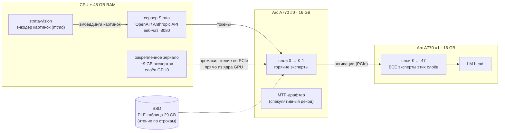

<h1 align="center">arc-moe</h1>

<p align="center"><b>Qwen3.8-Flash-Next (125B MoE) с картинками на двух Intel Arc A770</b><br>
Движок <a href="https://github.com/Niko1221/Strata">Strata</a>, доведённый до Alchemist: без FP64, с AOT-сборкой под <code>acm-g10</code>,<br>
с разделением слоёв на 2 карты, зеркалом экспертов в RAM и энкодером изображений на CPU</p>

<p align="center">
<code>2× Arc A770 16 GB</code> · <code>48 GB RAM</code> · <code>Ubuntu 24.04</code> · <code>OpenAI + Anthropic API</code> · <code>vision</code>
</p>

---

## Зачем это

[Strata](https://github.com/Niko1221/Strata) запускает Qwen3.8-Flash-Next, MoE на 125 миллиардов параметров
(24 576 экспертов, 10 на токен), на обычном игровом ПК. Для Intel у неё есть экспериментальный порт на SYCL, но его
писали и проверяли только на Battlemage (Arc Pro B70/B60/B50, B580). На **Arc A-series (Alchemist)** он не работает.
Причин несколько, и все они разобраны и исправлены здесь:

| # | Проблема в Strata на A770 | Что сделано в arc-moe |
|---|---|---|
| 1 | **У Alchemist нет FP64.** 8 файлов ядер (роутер экспертов, RMS-норма GDN/QSA, shared expert, сэмплер…) считают в `double`. AOT-сборка под `acm-g10` падает с `Double type is not supported on this platform`, а JIT падает при запуске ядра или уходит в программную эмуляцию FP64 в 10–100× медленнее | Тип аккумулятора `sfp_t` (`strata/sycl_fp.hpp`): на A770 это `float`, на Battlemage по-прежнему `double`. **Сканер SPIR-V** (`./arc check-fp64`) доказывает: 84 единицы трансляции, 0 инструкций FP64 |
| 2 | **SYCL-порт не собирается** на текущем `main`, `v0.1.40` и `v0.1.40.1`: `fused_gr_read_multi`, `Gemm::bf16`, `load_experts_gguf` разошлись с мигрированными копиями | Бисекцией найден последний собираемый коммит, `a5682fe` (0.1.39 + оба SYCL-фикса). На нём же сообщество получило 56–61 tok/s на 2× B60 |
| 3 | **Зеркало экспертов ломается при layer-split.** Список «промахов» для закреплённого зеркала в RAM обходил все 48 слоёв, поэтому RAM уходила на экспертов второй карты (они уже у неё в VRAM), а реальные промахи первой карты шли на SSD. Апстрим советует просто выключать зеркало (`STRATA_MIRROR_MIB=0`) | Зеркало строится только для слоёв первой карты. Авторазрез (`--layer-split auto`) оценивает промахи первой карты как чтение по PCIe (`STRATA_SPLIT_MIRROR_MS`) и сам выбирает границу, при которой **вторая карта держит свои слои целиком** |
| 4 | `STRATA_VERIFY_NO_HOST=1` (быстрый путь, где хост не участвует в каждом слое) зависает, если хоть один эксперт не лежит ни в VRAM, ни в зеркале | Режим `auto`: движок включает его только после расстановки, если покрытие полное, а иначе выключает и пишет почему |
| 5 | Запуск только через Docker-образ на основе стороннего образа llama.cpp; картинки на Intel отключены | Нативный раннер (`strata-sycl-native.sh`). Картинки работают через CPU-энкодер (`strata-vision`, mtmd из llama.cpp), так что VRAM обеих карт остаётся под экспертов |
| 6 | Кэш экспертов — одна аллокация на 10–15 ГБ, а у A770 `max_mem_alloc_size` около 4 ГБ | `-ze-opt-greater-than-4GB-buffer-required` для всех ядер и `UR_L0_ENABLE_RELAXED_ALLOCATION_LIMITS=1` |
| 7 | **Компилятор IGC падает** (`Internal Compiler Error: Floating point exception`) на 7 XMX-модулях (`joint_matrix` 16×16×16 — форма DPAS Battlemage, у Alchemist 8×8×16), и AOT-линковка движка обрывается | `STRATA_SYCL_NO_XMX`: эти опциональные ядра (на B70 они и так медленнее штатного пути) собираются заглушками, вызывающий код идёт штатным путём |
| 8 | Даже `a5682fe` **не линкуется**: апстримный #871 добавил `resident_plan` 14-й параметр в общий заголовок, а SYCL-копию не обновили | Параметр `plan_err` с семантикой #871 перенесён в SYCL-ядро |
| 9 | Если у CPU есть встроенная графика Intel, Level Zero видит её как `level_zero:0`, и разрез на «две карты» попадает на iGPU | Селектор `arc`: раннер через `sycl-ls` выбирает только дискретные Arc |
| 10 | Первый же запрос **вешал GPU 0** (`i915 GPU HANG`): роутер экспертов выходил 7 из 8 подгрупп и потом ставил барьер на всю группу. На CUDA это проходит, а на Alchemist барьер ждёт и вышедшие потоки, поэтому ядро не завершалось | Лишний барьер убран (значения в регистрах). Остальные 30 ранних `return` перед барьерами во всех ядрах проверены: там выходит вся группа целиком |

## Как это устроено



- **Модель:** Qwen3.8-Flash-Next в кванте **IQ2_XS** от ISTA-DASLab (GSQ-RCO): все 512 экспертов на слой, без
  урезания. Strata рекомендует этот квант как баланс качества и скорости. Это не урезанный Coder на половине
  экспертов и не 1-битный IQ1_M.
- **Две карты:** слои делятся между ними (`--layer-split auto`). Вторая карта целиком держит свои слои вместе с
  LM head. Первая держит самых горячих экспертов своих слоёв, остальные лежат в закреплённой RAM, и GPU читает их
  сам по PCIe внутри окна декода, без участия CPU.
- **Спекулятивный декод:** MTP-слой модели угадывает по 4 токена, большая модель проверяет их одним окном.
  На коде принимается 70–85% черновиков.
- **Картинки:** `mmproj` модели на CPU, около 3 с на картинку на 8 ядрах. В VRAM энкодер не занимает ничего.

## Скорость

> **Замеры на живых 2× A770 (IQ2_XS, 32K, `./arc profile`):**
>
> | | было (bb19834) | сейчас (23394f0) |
> |---|---|---|
> | Чтение промпта, 2K токенов | 49 tok/s | **497 tok/s** |
> | Чтение промпта, 10.7K токенов | ~45 tok/s | **589 tok/s** (18 с) |
> | Декод, код | 16.8 tok/s | **21.6 tok/s** |
> | Декод, проза | 11.9 tok/s | 14.0 tok/s |
>
> Цель: 35–40 tok/s декода и ~1000 tok/s чтения. Где уходит время, показывает `./arc profile`
> (подробности в [docs/ENGINEERING.md](docs/ENGINEERING.md), раздел 9). Ниже для ориентира цифры Strata на соседнем железе.

| Железо | Модель | Декод tok/s | Источник |
|---|---|---|---|
| Arc Pro B70 32 GB (608 GB/s), 1 карта, 8.4 GiB экспертов в зеркале | IQ2_XS | 50.8 – 60.6 | Strata `docs/INTEL.md` |
| 2× Arc Pro B60 24 GB (456 GB/s), всё в VRAM | IQ2_XS | 55.5 – 61.3 код, 38.8 – 40.0 текст | Strata `bench/results/…2x-arc-pro-b60` |
| **2× Arc A770 16 GB (560 GB/s), ~9 GiB в зеркале** | **IQ2_XS** | **ожидаемо 30 – 45** | arc-moe, прогноз |

У A770 пропускная способность памяти между B60 и B70, но архитектура Xe-HPG старше Xe2 (выше задержки
запуска ядер, драйвер `i915`). Отсюда консервативная цель **30–40 tok/s на коде** и немного меньше на прозе.

## Быстрый старт

```bash
git clone --recursive https://github.com/mqxl/arc-moe && cd arc-moe

./arc deps      # драйвер Level Zero, oneAPI (icpx + oneMKL), ocloc, cmake/ninja           (sudo, ~10 мин)
./arc doctor    # проверка: обе A770, ReBAR, PCIe, группа render, RAM, диск
./arc build     # Strata + патчи arc-moe, AOT-компиляция под acm-g10                          (~30–60 мин)
./arc setup     # скачать IQ2_XS (~70 GB) или взять свои GGUF, собрать энкодер картинок, запустить
```

Модель уже лежит на SSD? Отдайте папку с шардами, и ничего скачиваться не будет:

```bash
./arc setup --gguf-dir /mnt/ssd/Qwen3.8-Flash-Next-IQ2_XS
```

Дальше:

```bash
./arc start     # сервер на http://127.0.0.1:8080 (веб-чат, Monitor, API)
./arc bench     # скорость: prompt и decode tok/s по таймингам сервера
./arc profile   # куда уходит время: три прогона с профайлерами движка в один файл (~10 мин)
./arc service   # автозапуск при загрузке (systemd)
```

## Модели

| `--model` | Эксперты | Где живут на 2× A770 + 48 GB | Качество | Скорость |
|---|---|---|---|---|
| **IQ2_XS** (по умолчанию) | 35.5 GB, все 512/слой | ~26 GB VRAM + ~9 GB зеркало | хорошее, рекомендация Strata | **цель 30–40 tok/s** |
| Q2_0 | 34 GB | ~26 GB VRAM + ~8 GB зеркало | чуть ниже IQ2_XS | быстрее всех |
| IQ3_XXS | 43 GB | ~26 GB VRAM + ~17 GB зеркало | заметно лучше | медленнее (больше трафика по PCIe) |
| Coder (IQ1_M) | 23 GB, 256/слой | всё в VRAM | только код | самый быстрый, но урезан |

```bash
./arc setup --model IQ3_XXS        # «режим качества»
./arc setup --context 65536        # длинный контекст: KV-кэш стримится из RAM
./arc setup --host 0.0.0.0 --api-key СЕКРЕТ   # доступ из локальной сети
```

## Использование

**Веб-чат:** `http://<сервер>:8080`, там же вкладка **Monitor**. Картинку можно прикрепить кнопкой **Picture**.

**OpenAI API** (любой клиент, base URL `http://<сервер>:8080/v1`, ключ и имя модели любые):

```python
import base64, openai
c = openai.OpenAI(base_url="http://192.0.2.10:8080/v1", api_key="x")
img = base64.b64encode(open("photo.jpg", "rb").read()).decode()
r = c.chat.completions.create(model="qwen", messages=[{"role": "user", "content": [
    {"type": "text", "text": "Что на фото?"},
    {"type": "image_url", "image_url": {"url": f"data:image/jpeg;base64,{img}"}}]}])
print(r.choices[0].message.content)
```

**Anthropic API / Claude Code:** `ANTHROPIC_BASE_URL=http://192.0.2.10:8080 claude`

**Рассуждения:** `reasoning_effort` = `none` / `low` / `medium` / `high`. Без рассуждений ответ самый быстрый.

## Тонкая настройка

Переменные окружения движка лежат в секции `"env"` файла `third_party/strata/strata-iq2_xs.json`:

| Переменная | По умолчанию | Что делает |
|---|---|---|
| `STRATA_SPLIT_MIRROR_MS` | `25` | Цена промаха первой карты при поиске разреза. Больше — граница сдвигается так, чтобы на первой карте было меньше промахов |
| `STRATA_MIRROR_MIB` | MemAvailable − 4 GiB | Лимит закреплённого зеркала в RAM. `0` выключает зеркало |
| `STRATA_VERIFY_NO_HOST` | `auto` | Окно декода без участия хоста. `auto` включает его только при полном покрытии экспертов |
| `STRATA_VERIFY_DEVICE_PLAN` | `1` | GPU сам строит план слоя |
| `ONEAPI_DEVICE_SELECTOR` | `arc` | Какие карты видит движок. `arc` значит все дискретные Arc, встроенная графика CPU исключается |
| `UR_L0_ENABLE_RELAXED_ALLOCATION_LIMITS` | `1` | Разрешает аллокации больше 4 ГБ (кэш экспертов) |

Сборка: `ARC_AOT=acm-g10` (A770/A750), `acm-g12` (A580), `acm-g11` (A380/A310).
`ARC_IGC_EXTRA=-ze-opt-large-register-file` — экспериментальный режим 256 регистров для ядер SIMD32.

Разрез можно задать вручную: в конфиге `"layer_split": "30"` значит, что вторая карта начинает со слоя 30.
Какой разрез выбрал `auto`, видно в логе `strata-iq2_xs.log`, в строке `layer split auto: K=…`.

## Что важно для скорости на A770

1. **Resizable BAR включён** (BIOS: *Above 4G Decoding* + *Re-Size BAR Support*). Без него A-series теряет много
   производительности. `./arc doctor` это проверяет.
2. **PCIe 4.0 x8 или лучше на каждой карте.** Через этот канал GPU читает экспертов из зеркала.
3. **Пользователь в группе `render`**, иначе `sycl-ls` увидит только CPU.
4. **Governor `performance`**: в каждом окне декода хост-часть критична к задержкам.
5. **Ничего больше не держит VRAM** (рабочий стол на iGPU или без монитора).

## Проблемы

| Симптом | Что делать |
|---|---|
| `sycl-ls` не видит GPU | `./arc doctor`: группа `render`, пакет `libze-intel-gpu1`, перелогиниться |
| `ExpertCache: cudaMalloc(… GiB) failed` | В окружении нет `UR_L0_ENABLE_RELAXED_ALLOCATION_LIMITS=1` (его ставит `./arc setup`) |
| `STRATA_VERIFY_NO_HOST=auto -> off` | Не все эксперты поместились в VRAM + зеркало: закройте программы, съедающие RAM, или уменьшите `--context` |
| Медленно, часто моргает SSD | Зеркало маленькое (мало свободной RAM), промахи идут на SSD. Проверьте строку `mirrored in pinned host memory` в логе |
| `GPU HANG` в `dmesg` на первом запросе | Запустите с `STRATA_VERIFY_EAGER=1 STRATA_VERIFY_STEPLOG=1`: последняя строка `verify step:` в логе показывает, на каком ядре зависла карта |
| Первый ответ медленный | Первый запуск заполняет VRAM из GGUF (~1 мин) и читает PLE-таблицу с SSD. Дальше быстро |

Лог движка: `third_party/strata/strata-iq2_xs.log`. Проверка без GPU: `./arc check-fp64`.

## Устройство репозитория

```
arc                       единая точка входа (./arc help)
patches/strata/*.patch    изменения поверх Strata a5682fe (git format-patch, применяются в third_party/strata)
third_party/strata        Strata (подмодуль, закреплён на a5682fe)
scripts/                  deps, doctor, build, setup, start, bench, service, check-fp64
tools/check_fp64.py       сканер SPIR-V: какие device-функции ещё считают в double
tools/bench.py            замер tok/s через API
docs/ENGINEERING.md       подробности: как найдено, что изменено, почему так
```

## Благодарности и лицензия

- [Strata](https://github.com/Niko1221/Strata) (Niko1221 и контрибьюторы, MIT): движок, сервер и веб-приложение.
  SYCL-порт написал maxfridbe ([#423](https://github.com/Niko1221/Strata/pull/423)).
- [Qwen3.8-Flash-Next](https://huggingface.co/Qwen/Qwen3.8-Flash-Next) — команда Qwen; кванты GSQ-RCO — [ISTA-DASLab](https://huggingface.co/ISTA-DASLab/Qwen3.8-Flash-Next-GSQ-RCO-GGUF).
- [llama.cpp / ggml](https://github.com/ggml-org/llama.cpp): CPU-ядра экспертов и энкодер картинок (mtmd).

Код arc-moe распространяется под MIT ([LICENSE](LICENSE)). У Strata и у моделей свои лицензии.
