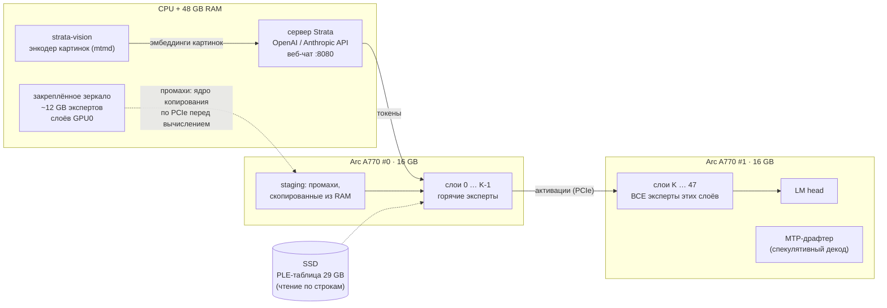

<h1 align="center">arc-moe</h1>

<p align="center"><b>Qwen3.8-Flash-Next (125B MoE) с картинками на Intel Arc A770: одна карта или две</b><br>
Движок <a href="https://github.com/Niko1221/Strata">Strata</a>, доведённый до Alchemist: без FP64, с AOT-сборкой под карту этого ПК,<br>
с разделением слоёв на 2 карты, зеркалом экспертов в RAM и энкодером изображений на CPU</p>

<p align="center">
<code>1–2× Arc A770 16 GB</code> · <code>32–48 GB RAM</code> · <code>Ubuntu 24.04</code> · <code>OpenAI + Anthropic API</code> · <code>vision</code>
</p>

---

## Зачем это

[Strata](https://github.com/Niko1221/Strata) запускает Qwen3.8-Flash-Next, MoE на 125 миллиардов параметров
(24 576 экспертов, 10 на токен), на обычном игровом ПК. Для Intel у неё есть экспериментальный порт на SYCL, но его
писали и проверяли только на Battlemage (Arc Pro B70/B60/B50, B580). На **Arc A-series (Alchemist)** он не работает.
Причин несколько, и все они разобраны и исправлены здесь:

| # | Проблема в Strata на A770 | Что сделано в arc-moe |
|---|---|---|
| 1 | **У Alchemist нет FP64.** 8 файлов ядер (роутер экспертов, RMS-норма GDN/QSA, shared expert, сэмплер…) считают в `double`. AOT-сборка под `acm-g10` падает с `Double type is not supported on this platform`, а JIT падает при запуске ядра или уходит в программную эмуляцию FP64 в 10–100× медленнее | Тип аккумулятора `sfp_t` (`strata/sycl_fp.hpp`): на A770 это `float`, на Battlemage по-прежнему `double`. **Сканер SPIR-V** (`./arc check-fp64`) доказывает: 84 единицы трансляции, 0 инструкций FP64 |
| 2 | **SYCL-порт не собирается** на текущем `main`, `v0.1.40` и `v0.1.40.1`: `fused_gr_read_multi`, `Gemm::bf16`, `load_experts_gguf` разошлись с мигрированными копиями | Бисекцией найден последний собираемый коммит, `a5682fe` (0.1.39 + оба SYCL-фикса). На нём же сообщество получило 56–61 tok/s на 2× B60 |
| 3 | **Зеркало экспертов ломается при layer-split.** Список «промахов» для закреплённого зеркала в RAM обходил все 48 слоёв, поэтому RAM уходила на экспертов второй карты (они уже у неё в VRAM), а реальные промахи первой карты шли на SSD. Апстрим советует просто выключать зеркало (`STRATA_MIRROR_MIB=0`) | Зеркало строится только для слоёв первой карты. Авторазрез (`--layer-split auto`) оценивает промахи первой карты как чтение по PCIe (`STRATA_SPLIT_MIRROR_MS`) и сам выбирает границу, при которой **вторая карта держит свои слои целиком** |
| 4 | `STRATA_VERIFY_NO_HOST=1` (быстрый путь, где хост не участвует в каждом слое) зависает, если хоть один эксперт не лежит ни в VRAM, ни в зеркале | Режим `auto`: движок включает его только после расстановки, если покрытие полное, а иначе выключает и пишет почему |
| 5 | Запуск только через Docker-образ на основе стороннего образа llama.cpp; картинки на Intel отключены | Нативный раннер (`strata-sycl-native.sh`). Картинки работают через CPU-энкодер (`strata-vision`, mtmd из llama.cpp), так что VRAM обеих карт остаётся под экспертов |
| 6 | Кэш экспертов — одна аллокация на 10–15 ГБ, а у A770 `max_mem_alloc_size` около 4 ГБ | `-ze-opt-greater-than-4GB-buffer-required` для всех ядер и `UR_L0_ENABLE_RELAXED_ALLOCATION_LIMITS=1` |
| 7 | **Компилятор IGC падает** (`Internal Compiler Error: Floating point exception`) на 7 XMX-модулях (`joint_matrix` 16×16×16 — форма DPAS Battlemage, у Alchemist 8×8×16), и AOT-линковка движка обрывается | Неподдерживаемые формы остаются заглушками. Отдельные SG8 8×8×16 ядра экспертов и attention собираются для Alchemist и доступны под переключателями; корректность и скорость проверяются отдельно. Для экспертов XMX оказался медленнее tile16, поэтому по умолчанию используется DP4A |
| 8 | Даже `a5682fe` **не линкуется**: апстримный #871 добавил `resident_plan` 14-й параметр в общий заголовок, а SYCL-копию не обновили | Параметр `plan_err` с семантикой #871 перенесён в SYCL-ядро |
| 9 | Если у CPU есть встроенная графика Intel, Level Zero видит её как `level_zero:0`, и разрез на «две карты» попадает на iGPU | Селектор `arc`: раннер через `sycl-ls` выбирает только дискретные Arc |
| 10 | Первый же запрос **вешал GPU 0** (`i915 GPU HANG`): роутер экспертов выходил 7 из 8 подгрупп и потом ставил барьер на всю группу. На CUDA это проходит, а на Alchemist барьер ждёт и вышедшие потоки, поэтому ядро не завершалось | Лишний барьер убран (значения в регистрах). Остальные 30 ранних `return` перед барьерами во всех ядрах проверены: там выходит вся группа целиком |
| 11 | Ядра декода, настроенные под Xe2, на Alchemist **упирались в регистры**: IGC для `acm-g10` не включает большой регистровый файл сам, и почти каждый GEMV сливал по 3–17 KB на поток в scratch. Аргументы hyper-connection (936 байт) копировались в private-память каждым потоком | Сборка с `-ze-opt-large-register-file` (0 спиллов в ядрах декода), аргументы hc-ядер в памяти устройства. Найдено офлайн по дампам IGC |
| 12 | Эксперты, которых нет в VRAM, ядра GEMV читали **прямо из RAM по PCIe**, по нескольку байт на поток: ядро gate/up от 3,7 мкс до 4,4 мс за вызов | План на GPU отправляет их в «PCIe-группы»: одно широкое ядро копирования переносит их в staging-буфер VRAM, и только потом они считаются |
| 13 | Настройки ядер подобраны под Xe2: 8 лейнов на строку в GEMV экспертов, резерв VRAM 1,5 ГБ, окно 6 токенов | Подобраны на A770 замерами `./arc profile`: 32 лейна (+18% на коде), резерв 768 МБ, окно 8 токенов |
| 14 | Проект был заточен под одну машину | Цель сборки (`acm-g10/g11/g12`) берётся из PCI ID карт, `./arc doctor` считает план под RAM и VRAM этого ПК, режим одна/две карты выбирается при запуске (`ARC_GPUS`) |
| 15 | Через OpenRouter, OpenAI SDK и агентские харнессы модель отвечала **`!!!!!!!`**. Такие клиенты всегда шлют `temperature`/`top_p`, а ядра сэмплинга (и драфтер MTP) проверяли наличие FP64, которого у A770 нет. Бенч этого не видел: он жадный (`temperature: 0`) и текст не проверял | Проверка FP64 снята в сборке без FP64 (там вся арифметика во float), ошибка сэмплинга возвращается как ошибка запроса, `repetition_penalty: 0` больше не делит логиты на ноль. `tools/bench.py` теперь проверяет каждый ответ и умеет кейсы `sampled` и `agent` (system + tools + stream + штрафы), `./arc profile` гоняет их |
| 16 | **Любой длинный промпт** (OpenCode, агенты, всё от ~1K токенов) давал `!!!!`. Пакетный prefill с `--prefill-borrow` кладёт свои буферы в «одолженные» последние слоты кэша экспертов, а это 7–11 ГБ от начала одной аллокации в 11 ГБ. GEMM oneMKL (их ядра собраны не нами, флаг `-ze-opt-greater-than-4GB-buffer-required` до них не доходит) на таких адресах считали мусор уже в первой проекции слоя 0; наши ядра на той же памяти работали. Бенч этого не ловил: он не проверял текст, а суффикс-драфтер принимал «!!!» на 100% | Слоты native-пакета разложены в аллокации в обратном порядке: одалживаемые (самые редкие эксперты) лежат в её первых 4 ГБ, правила по индексам слотов не менялись (`STRATA_CACHE_TAIL_LOW=0` вернёт старую раскладку). После каждого пакетного промпта движок проверяет последнюю строку состояния: NaN даёт ошибку запроса, а не мусор. `./arc check` гоняет и промпты на 10K |

## Одна карта или две, на любом ПК с A770

Ничего не привязано к конкретной машине: `./arc build` берёт цель компиляции из PCI ID установленных Arc, а
`./arc doctor` считает, сколько экспертов поместится в VRAM, сколько уйдёт в зеркало в RAM и хватит ли памяти.
Это делается для обоих режимов.

| | Одна A770 16 GB | Две A770 16 GB |
|---|---|---|
| Как включить | `./arc setup --gpus 0`, или `ARC_GPUS=0 ./arc start` на конфиге для двух карт | по умолчанию, если в системе два Arc |
| Эксперты в VRAM | ~10 GB | ~21 GB |
| Зеркало в RAM | ~26 GB | ~14 GB |
| RAM нужно | от 40 ГБ (лучше 48) | от 28 ГБ (лучше 32–48) |
| Слои | все 48 на одной карте | автоматический разрез, вторая карта держит свои слои целиком |
| Скорость (замер) | код 25–26 tok/s, prefill 10K 390–391 tok/s | код 33–37 tok/s, prefill 10K 472–476 tok/s; подробности ниже |

- **Слоты PCIe.** Вторая карта часто стоит в слоте x4 от чипсета (как на машине, где снимались замеры). Это нормально: ей
  почти не нужно читать из RAM. Важнее, чтобы первая карта была в x16.
- **ReBAR** обязателен (Above 4G decoding + Re-Size BAR в BIOS), `./arc doctor` его проверяет.
- **A750 / A580 (8 GB)** тоже работают, но экспертов в VRAM вдвое меньше, а значит, нужно больше RAM, и работают они медленнее.
- **Все оптимизации общие для архитектуры:** большой регистровый файл, ядра без спиллов, staging промахов, настройки
  лейнов и окна. Ни одна не зависит от конкретного ПК.

## Как это устроено



- **Модель:** Qwen3.8-Flash-Next в кванте **IQ2_XS** от ISTA-DASLab (GSQ-RCO): все 512 экспертов на слой, без
  урезания. Strata рекомендует этот квант как баланс качества и скорости. Это не урезанный Coder на половине
  экспертов и не 1-битный IQ1_M.
- **Две карты:** слои делятся между ними (`--layer-split auto`). Вторая карта целиком держит свои слои вместе с
  LM head. Первая держит самых горячих экспертов своих слоёв, остальные лежат в закреплённой RAM, и GPU читает их
  сам по PCIe внутри окна декода, без участия CPU.
- **Спекулятивный декод:** MTP-слой модели угадывает по 4 токена, большая модель проверяет их одним окном.
  На коде принимается 70–85% черновиков.
- **Картинки:** `mmproj` модели на CPU, около 3 с на картинку на 8 ядрах. В VRAM энкодер не занимает ничего.

## Скорость

Проверенный вариант — grouped IQ-эксперты с `STRATA_PF_EXPERT_KERNEL=tile16`,
`STRATA_PF_PIN_LOAN=2`, `STRATA_PF_PIN_REFILL=1`, контекст 32768,
`--prefill-borrow --prefill auto --vram-reserve-mib 768 --spec 6 --short-read 64`.
Ниже два запроса на каждый кейс из `profile-20261008-214426.txt`, таймер фаз выключен.

| Кейс | Две A770 16 GB | Одна A770 16 GB |
|---|---|---|
| Prefill 2K, tok/s | 331–343 | 320–326 |
| Prefill 10.7K, tok/s | 472–476 | 390–391 |
| Декод кода, tok/s | 34–35 | 25–26 |
| Декод русской прозы, tok/s | 19 | 14–15 |
| Декод после 10K, tok/s | 28–31 | 22–23 |

Полный `check-20261008-213531.txt`: 42/42 ответов корректны (base, own-buffers, one-gpu),
включая длинные запросы с tools/stream. Новые immutable-копии одалживаемых экспертов требуют
дополнительной закреплённой RAM (около 6.9 ГиБ на двух картах и 3.4 ГиБ на одной в этой настройке).
Пул ограничен доступной памятью; при нехватке движок сохраняет прежний путь, а прирост может уменьшиться.
Для A/B: `STRATA_PF_PIN_LOAN=0 STRATA_PF_PIN_REFILL=0 ./arc start`.
На этой машине также были два сбоя ядра в управлении памятью; проверки после перезагрузки прошли,
но первопричина сбоя хоста не установлена. Подробные положительные и отрицательные результаты — в ENGINEERING.
CPU-тест `memtester 4G 1` затем обнаружил 8 ошибок данных без работающего движка.
До исправления целостности памяти хоста дальнейшие проверки GPU и 128K остановлены; таблица относится к 32K,
а 1000 tok/s и долговременная стабильность ещё не достигнуты.

Второй запрос того же размера обычно быстрее первого. Скорость декода зависит от того, сколько
черновиков MTP принято, поэтому длинный промпт не гарантирует одинаковую скорость генерации.
Для двух карт `profile-20261008-022225.txt` показывает рост медианы 10K с 367 до 430 tok/s
при замене четырёхстрочного DP4A на tile16 (+17%). Для одной карты сопоставимый прогон
`profile-20261008-214426.txt`: 314 → 372 tok/s (+18.3%). Полные проверки base / own-buffers /
one-gpu, включая два запроса на 10K, проходят. Числа фазового профайлера не используются как итоговая скорость.

Порог short-read 64 в `profile-20261008-012913.txt` даёт полный ответ на агентский запрос
(311 токенов промпта) за 3.3–4.0 с, на 0.7K — за 7.0–7.5 с. Старый порог 1536 давал
около 8 с на агента и 15 с на 0.7K. Это замер двух карт; выбор порога для одной проверяется отдельно.

Исторические 814–997 tok/s из раундов до исправления адресов заёмного кеша были получены
при NaN: все токены попадали в одни эксперты, а ответ состоял из `!`. Эти цифры не являются
ускорением. До grouped-пути корректный FP16/oneMKL prefill давал около 175 tok/s на двух картах.

Подробные A/B-замеры, численная проверка ядер и неудачные варианты — в
[docs/ENGINEERING.md](docs/ENGINEERING.md). `./arc profile` сохраняет итоговые скорости,
прогон A — распределение времени по фазам; `./arc check` проверяет ответы.

## Быстрый старт

```bash
git clone --recursive https://github.com/mqxl/arc-moe && cd arc-moe

./arc deps      # драйвер Level Zero, oneAPI (icpx + oneMKL), ocloc, cmake/ninja           (sudo, ~10 мин)
./arc doctor    # проверка: карты, ReBAR, PCIe, группа render, RAM, диск и план «одна/две карты» под этот ПК
./arc build     # Strata + патчи arc-moe, AOT-компиляция под карты этого ПК (A770: acm-g10)    (~30–60 мин)
./arc setup     # скачать IQ2_XS (~70 GB) или взять свои GGUF, собрать энкодер картинок, запустить
```

Модель уже лежит на SSD? Отдайте папку с шардами, и ничего скачиваться не будет:

```bash
./arc setup --gguf-dir /mnt/ssd/Qwen3.8-Flash-Next-IQ2_XS
```

Дальше:

```bash
./arc start     # сервер на http://127.0.0.1:8080 (веб-чат, Monitor, API)
./arc bench     # скорость: prompt и decode tok/s по таймингам сервера
./arc profile   # куда уходит время: прогоны с профайлерами движка и A/B настроек в один файл (~30 мин)
./arc service   # автозапуск при загрузке (systemd)
```

## Модели

| `--model` | Эксперты | Где живут на 2× A770 (на одной: VRAM ~10 GB, остальное в зеркале) | Качество | Скорость |
|---|---|---|---|---|
| **IQ2_XS** (по умолчанию) | 35.5 GB, все 512/слой | ~21 GB VRAM + ~14 GB зеркало | хорошее, рекомендация Strata | **34 tok/s код** |
| Q2_0 | 34 GB | ~21 GB VRAM + ~13 GB зеркало | чуть ниже IQ2_XS | быстрее всех |
| IQ3_XXS | 43 GB | ~21 GB VRAM + ~22 GB зеркало (нужно 48 GB RAM) | заметно лучше | медленнее (больше трафика по PCIe) |
| Coder (IQ1_M) | 23 GB, 256/слой | всё в VRAM | только код | самый быстрый, но урезан |

```bash
./arc setup --model IQ3_XXS        # «режим качества»
./arc setup --context 65536        # длинный контекст: KV-кэш стримится из RAM
./arc setup --host 0.0.0.0 --api-key СЕКРЕТ   # доступ из локальной сети
```

## Использование

**Веб-чат:** `http://<сервер>:8080`, там же вкладка **Monitor**. Картинку можно прикрепить кнопкой **Picture**.

**OpenAI API** (любой клиент, base URL `http://<сервер>:8080/v1`, ключ и имя модели любые):

```python
import base64, openai
c = openai.OpenAI(base_url="http://<сервер>:8080/v1", api_key="x")
img = base64.b64encode(open("photo.jpg", "rb").read()).decode()
r = c.chat.completions.create(model="qwen", messages=[{"role": "user", "content": [
    {"type": "text", "text": "Что на фото?"},
    {"type": "image_url", "image_url": {"url": f"data:image/jpeg;base64,{img}"}}]}])
print(r.choices[0].message.content)
```

**Anthropic API / Claude Code:** `ANTHROPIC_BASE_URL=http://<сервер>:8080 claude`

**Рассуждения:** `reasoning_effort` = `none` / `low` / `medium` / `high`. Без рассуждений ответ самый быстрый.

## Тонкая настройка

Переменные окружения движка лежат в секции `"env"` файла `third_party/strata/strata-iq2_xs.json`:

| Переменная | По умолчанию | Что делает |
|---|---|---|
| `STRATA_SPLIT_MIRROR_MS` | `25` | Цена промаха первой карты при поиске разреза. Больше — граница сдвигается так, чтобы на первой карте было меньше промахов |
| `STRATA_MIRROR_MIB` | MemAvailable − 4 GiB | Лимит закреплённого зеркала в RAM. `0` выключает зеркало |
| `STRATA_VERIFY_NO_HOST` | `auto` | Окно декода без участия хоста. `auto` включает его только при полном покрытии экспертов |
| `STRATA_VERIFY_DEVICE_PLAN` | `1` | GPU сам строит план слоя |
| `ONEAPI_DEVICE_SELECTOR` | `arc` | Какие карты видит движок. `arc` значит все дискретные Arc, встроенная графика CPU исключается |
| `UR_L0_ENABLE_RELAXED_ALLOCATION_LIMITS` | `1` | Разрешает аллокации больше 4 ГБ (кэш экспертов) |

Запуск (`./arc start` ставит их сам; заданная вами переменная, даже пустая, побеждает):

| Переменная | По умолчанию | Что делает |
|---|---|---|
| `ARC_GPUS` | все Arc | `0` — только первая карта, `1` — только вторая, `0,1` — обе (разрез слоёв) |
| `STRATA_EXTRA_ARGS` | `--prefill-borrow --prefill auto --vram-reserve-mib 768 --spec 6` | Флаги движка поверх конфига: чанки промпта по 8K в одолженных слотах, резерв VRAM, окно 8 токенов |
| `STRATA_GU_LANES` | `32` | Лейнов на строку в GEMV gate/up экспертов (апстрим: 8) |
| `STRATA_PREFILL_FIRST` | `0` | Короткий первый чанк промпта выключен (на A770 это лишний проход по экспертам) |

Сборка: цель берётся из PCI ID карт (`acm-g10` — A770/A750/A580, `acm-g11` — A380/A310, `acm-g12` — Arc Pro A60);
`ARC_AOT=…` задаёт её вручную. Большой регистровый файл включён по умолчанию (`ARC_LARGE_GRF=OFF` для A/B).

Разрез можно задать вручную: в конфиге `"layer_split": "30"` значит, что вторая карта начинает со слоя 30.
Какой разрез выбрал `auto`, видно в логе `strata-iq2_xs.log`, в строке `layer split auto: K=…`.

## Что важно для скорости на A770

1. **Resizable BAR включён** (BIOS: *Above 4G Decoding* + *Re-Size BAR Support*). Без него A-series теряет много
   производительности. `./arc doctor` это проверяет.
2. **Первая карта в слоте PCIe 4.0 x16.** Через него копируются эксперты из зеркала. Вторая карта может стоять и в x4: ей почти не нужно читать из RAM.
3. **Пользователь в группе `render`**, иначе `sycl-ls` увидит только CPU.
4. **Governor `performance`**: в каждом окне декода хост-часть критична к задержкам.
5. **Ничего больше не держит VRAM** (рабочий стол на iGPU или без монитора).

## Проблемы

| Симптом | Что делать |
|---|---|
| `sycl-ls` не видит GPU | `./arc doctor`: группа `render`, пакет `libze-intel-gpu1`, перелогиниться |
| `ExpertCache: cudaMalloc(… GiB) failed` | В окружении нет `UR_L0_ENABLE_RELAXED_ALLOCATION_LIMITS=1` (его ставит `./arc setup`) |
| `STRATA_VERIFY_NO_HOST=auto -> off` | Не все эксперты поместились в VRAM + зеркало: закройте программы, съедающие RAM, или уменьшите `--context` |
| Медленно, часто моргает SSD | Зеркало маленькое (мало свободной RAM), промахи идут на SSD. Проверьте строку `mirrored in pinned host memory` в логе |
| `GPU HANG` в `dmesg` на первом запросе | Запустите с `STRATA_VERIFY_EAGER=1 STRATA_VERIFY_STEPLOG=1`: последняя строка `verify step:` в логе показывает, на каком ядре зависла карта |
| Первый ответ медленный | Первый запуск заполняет VRAM из GGUF (~1 мин) и читает PLE-таблицу с SSD. Дальше быстро |

Лог движка: `third_party/strata/strata-iq2_xs.log`. Проверка без GPU: `./arc check-fp64`.

## Устройство репозитория

```
arc                       единая точка входа (./arc help)
patches/strata/*.patch    изменения поверх Strata a5682fe (git format-patch, применяются в third_party/strata)
third_party/strata        Strata (подмодуль, закреплён на a5682fe)
scripts/                  deps, doctor, build, setup, start, bench, service, check-fp64
tools/check_fp64.py       сканер SPIR-V: какие device-функции ещё считают в double
tools/bench.py            замер tok/s через API
docs/ENGINEERING.md       подробности: как найдено, что изменено, почему так
```

## Благодарности и лицензия

- [Strata](https://github.com/Niko1221/Strata) (Niko1221 и контрибьюторы, MIT): движок, сервер и веб-приложение.
  SYCL-порт написал maxfridbe ([#423](https://github.com/Niko1221/Strata/pull/423)).
- [Qwen3.8-Flash-Next](https://huggingface.co/Qwen/Qwen3.8-Flash-Next) — команда Qwen; кванты GSQ-RCO — [ISTA-DASLab](https://huggingface.co/ISTA-DASLab/Qwen3.8-Flash-Next-GSQ-RCO-GGUF).
- [llama.cpp / ggml](https://github.com/ggml-org/llama.cpp): CPU-ядра экспертов и энкодер картинок (mtmd).

Код arc-moe распространяется под MIT ([LICENSE](LICENSE)). У Strata и у моделей свои лицензии.
